# Awesome Contract Approval Workflow Automation ⚡

<div align="center">
  
</div>

<div align="center">

<a href="https://github.com/ishandutta2007/Awesome-Awesome-Awesome"></a><a href="https://discord.gg/jc4xtF58Ve"></a>
<a href="https://github.com/ishandutta2007/Awesome-Contract-Approval-Workflow-Automation/stargazers"></a>
<a href="https://github.com/ishandutta2007/Awesome-Contract-Approval-Workflow-Automation/network/members"></a>
<a href="https://github.com/ishandutta2007/Awesome-Contract-Approval-Workflow-Automation/issues"></a>
<a href="https://github.com/ishandutta2007/Awesome-Contract-Approval-Workflow-Automation/blob/main/LICENSE"></a>
<a href="https://github.com/ishandutta2007"></a>

</div>

<p align="center">
  <b>A curated catalog of enterprise SaaS platforms and self-hosted open-source orchestration engines for contract approval workflows, rule-based sign-off routing, and multi-stage legal ops automation.</b>
</p>

---

## 📑 Table of Contents
- [📊 Sector Overview & Market Dynamics](#-sector-overview--market-dynamics)
- [🏢 SaaS & Hosted Platforms](#-saas--hosted-platforms)
- [🔓 Open-Source GitHub Projects](#-open-source-github-projects)
- [🛠️ Workflow Architectural Patterns](#-workflow-architectural-patterns)
- [🤝 How to Contribute](#-how-to-contribute)
- [📈 Star History](#-star-history)
- [💖 Support & Sponsor](#-support--sponsor)
- [⚖️ Disclaimer](#-disclaimer)

---

## 📊 Sector Overview & Market Dynamics

The global **Contract Lifecycle Management (CLM)** market is valued at approximately **$2.5B–$3.4B in 2026** (projected to reach $8B+ by 2032 at an 11–13% CAGR), embedded within a broader **Workflow & Hyperautomation** market exceeding **$24B–$28B**.

The sector exhibits **high fragmentation** across the mid-market and legal-tech verticals, where specialized AI-first contract engines compete vigorously with niche legal ops tools; conversely, it reflects a **concentrated oligopoly at the top-tier enterprise level**, dominated by heavy platforms (ServiceNow, DocuSign, Icertis, Coupa) driven by extensive systems integration and multi-year master service agreements.

---

## 🏢 SaaS & Hosted Platforms

*All SaaS vendors are ordered below in descending order of market capitalization, enterprise valuation, or scale.*

| Product | Valuation / Scale | Pricing (Starting) | Free Tier / Trial Limits | Description |
|---|---|---|---|---|
| **[ServiceNow](https://www.servicenow.com/)** | ~$105B Market Cap | ~$100–$200/fulfiller/month ($840–$2,400/user/year; median ~$124K/year deployment) | 0 days free trial (Requires sales-led custom enterprise scoping; self-service CLM trial unavailable) | Enterprise workflow standard. Approvals routed via Flow Designer engine and `sysapproval_approver` tables with full role-based delegations. |
| **[DocuSign CLM](https://www.docusign.com/)** | ~$14.5B Market Cap | ~$20,000–$60,000/year base deployment (~$80/user/month for advanced IAM suites) | 0 days free trial for CLM (30-day trial available only for basic eSignature, full CLM requires sales demo) | Enterprise contract workflow automation with 100+ pre-built actions, conditional branch evaluation, and automated sign-off audit logging. |
| **[Tipalti](https://tipalti.com/)** | $8.3B Valuation | $99/month starting tier (Select Tier: $99/mo; Advanced Tier: $199/mo) | 0 days free trial (No free plan or self-serve trial; live platform demo required) | Accounts payable & procurement automation. Rule-based conditional routing for POs and contracts by amount, department, GL, or entity. |
| **[Coupa](https://www.coupa.com/)** | $8.0B Acquisition | ~$21,844/year starting base (Median contract ~$93,000/year across modules) | 0 days free trial (No self-serve trial; enterprise POC arranged via sales team) | Enterprise Business Spend Management (BSM) and CLM. AI agentic intake orchestrates contract approvals across legal and finance without skipping required steps. |
| **[Icertis](https://www.icertis.com/)** | ~$3.5B–$5.0B Valuation ($350M+ ARR) | ~$150–$350/user/month (Minimum contract typically $200,000 over multi-year terms) | 0 days free trial (No free plan or self-serve trial; sales-led pilot environment only) | AI-powered Contract Intelligence. Predefined clause deviation detection, dynamic reviewer assignment, and enterprise risk scoring. |
| **[Ironclad](https://ironcladapp.com/)** | $3.2B Valuation | ~$15,000/year minimum floor (Median contract ~$40,000/year; $50K–$120K/year mid-market) | 0 days free trial (No self-serve trial for core CLM; enterprise interactive tour and demo via sales) | Modern legal operating system with visual drag-and-drop workflow designer, property-based routing rules, and seamless Coupa/Salesforce handoffs. |
| **[Nintex](https://www.nintex.com/)** | ~$2.0B Valuation (TPG Capital) | ~$25,000/year entry floor (100-user deployments average $50,000–$150,000/year) | 30-day free trial (Full-featured access to Nintex Workflow Cloud, process mapping, and forms) | Enterprise process management, automated forms, multi-condition approval logic, and robotic document generation. |
| **[Conga](https://www.conga.com/)** | $1.25B Valuation | ~$35/user/month base license (Median tracked organization spend ~$17,179/year) | 0 days free trial (No self-serve CLM trial; scheduled product demonstration required) | Revenue lifecycle and contract orchestration. Leverages conditional Approval Rules and Approval Flows with unanimous or sequential thresholds. |
| **[Kissflow](https://kissflow.com/)** | ~$90M Annual Revenue | $2,500/month starting base (Billed annually; custom enterprise plans for AI copilot) | 0 days free trial (No self-serve free trial; custom proof-of-concept after solutions architect consult) | Low-code enterprise workflow builder. Visual rule editor, SLA escalation matrix, and parallel approver loops for corporate operations. |
| **[Agiloft](https://www.agiloft.com/)** | ~$50M–$70M Annual Revenue | ~$67,000/year median contract value (Modular enterprise licensing) | Free Forever Plan for Agiloft Astra AI (Unlimited users with basic contract intelligence; core CLM is demo-only) | Highly configurable no-code BPM and contract approval platform with deep compliance controls and granular role security. |

---

## 🔓 Open-Source GitHub Projects

*Open-source workflow engines, approval orchestrators, and digital agreement frameworks sorted by GitHub stars in descending order.*

| Project | Stars | Language | Primary Approval & Automation Capabilities |
|---|:---:|:---:|---|
| **[n8n](https://github.com/n8n-io/n8n)** | [](https://github.com/n8n-io/n8n/stargazers) | TypeScript | Fair-code visual workflow automation engine. Supports multi-stage contract routing, human-in-the-loop approval triggers via Slack/Email, webhook callbacks, and 400+ pre-built integrations. |
| **[Activepieces](https://github.com/activepieces/activepieces)** | [](https://github.com/activepieces/activepieces/stargazers) | TypeScript | Open-source alternative to Zapier & Make. Offers visual canvas builder, pause-and-resume approval flows, condition branching, and MIT-licensed community edition. |
| **[Temporal](https://github.com/temporalio/temporal)** | [](https://github.com/temporalio/temporal/stargazers) | Go | Resilient orchestration engine for mission-critical, long-running business workflows. Guarantees deterministic state execution for approvals lasting days, weeks, or months without dropping state. |
| **[Node-RED](https://github.com/node-red/node-red)** | [](https://github.com/node-red/node-red/stargazers) | JavaScript | Flow-based visual programming environment. Lightweight runtime ideal for wiring together document APIs, approval routing webhooks, and real-time alert notifications. |
| **[Windmill](https://github.com/windmill-labs/windmill)** | [](https://github.com/windmill-labs/windmill/stargazers) | Rust / TypeScript | Ultra-fast developer-first workflow platform. Converts Python, TypeScript, and Bash scripts into interactive internal approval UIs, multi-step flows, and schedulers. |
| **[Documenso](https://github.com/documenso/documenso)** | [](https://github.com/documenso/documenso/stargazers) | TypeScript | Open-source digital signing infrastructure. Enables automated sequential document signing pipelines, recipient role ordering, and audit certificate generation. |
| **[Automatisch](https://github.com/automatisch/automatisch)** | [](https://github.com/automatisch/automatisch/stargazers) | JavaScript | Self-hosted business automation tool without cloud vendor lock-in. Designed for privacy-conscious organizations requiring local execution of contract sign-off events. |
| **[Camunda](https://github.com/camunda/camunda)** | [](https://github.com/camunda/camunda/stargazers) | Java | Complete enterprise process orchestration standard based on BPMN 2.0 and DMN (Decision Model and Notation). Perfect for complex, regulated approval matrix evaluation. |
| **[MEL Agent](https://github.com/cedricziel/mel-agent)** | [](https://github.com/cedricziel/mel-agent/stargazers) | Go / React | AI-first workflow automation platform with visual canvas inspired by n8n. API-first architecture designed for custom node extensions and automated agentic routing. |

---

## 🛠️ Workflow Architectural Patterns

When architecting a self-hosted or hybrid contract approval pipeline, standard patterns include:

```
[Contract Ingestion / CRM] ──> [Intake & Parsing]
                                      │
                                      ▼
                      [Conditional Rule Engine (DMN/DSL)]
                       ├── Value > $50,000? ──> [CFO Sign-off]
                       ├── Clause Deviation? ─> [Legal Ops Review]
                       └── Standard Terms? ───> [Automated Fast-Track]
                                      │
                                      ▼
                      [Immutable Audit Log & Signature]
                       └── Documenso / eSign API ──> [Repository Archive]
```

---

## 🤝 How to Contribute

Contributions to expand this curated landscape are welcome!

1. 🍴 **Fork the repository**
2. 🌿 **Create your feature branch**: `git checkout -b feature/add-new-tool`
3. ✍️ **Add your entry**: Follow the existing Markdown table format, including verified starting pricing, trial terms, and GitHub star badges
4. 🚀 **Submit a Pull Request** with a concise description of the platform's approval workflow capabilities

---

## 📈 Star History

[](https://www.star-history.com/#ishandutta2007/Awesome-Contract-Approval-Workflow-Automation&type=date&legend=top-left)

---

## 💖 Support & Sponsor

If you found this curated list helpful for your legal engineering, procurement, or developer workflow:

- ⭐ **Star this repository** to help others discover it
- 🔄 **Fork and share** with your engineering and legal ops teams
- ☕ **Support future maintenance and updates** by sponsoring via the [Sponsor Dashboard](https://github.com/sponsors/ishandutta2007)

---

## ⚖️ Disclaimer

- This repository is a **community-curated index** intended for architectural research and product benchmarking.
- Pricing metrics, valuations, and trial policies change periodically. Please consult vendor product documentation directly for final enterprise procurement figures.
